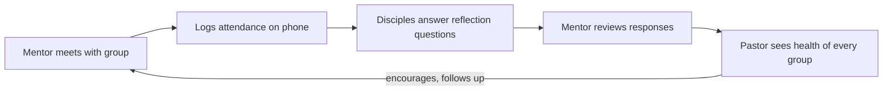

# 🐑 Flock

**Flock helps churches keep track of their discipleship groups. Mentors log each meeting from their phone, disciples reflect on what they learned, and pastors can see how every group is doing in one place.**

> _"And he gave the apostles, the prophets, the evangelists, the shepherds and teachers, to equip the saints for the work of ministry, for building up the body of Christ."_ — Ephesians 4:11–12

---

## Why Flock exists

Discipleship works best _life on life_: a small group of people meeting regularly, talking honestly, and growing together. Small groups like this are where real growth happens, but they're also where pastors lose track of things quickly:

- **Pastors can't see what's going on.** A pastor with ten groups usually only finds out a group has stopped meeting weeks later, through word of mouth.
- **Mentors lose track.** Who came last week? What did we talk about? How is each disciple really doing? It ends up scattered across WhatsApp chats, notebooks and memory.
- **Disciples rarely stop to reflect.** Without a small prompt after each meeting, the lessons of the week fade fast.
- **Generic tools don't fit.** Spreadsheets, church management systems (ChMS) and messaging apps don't understand that a single person can **lead one group and be discipled in another**.

Flock is small and focused on purpose. It doesn't try to be a full church management system. It covers one loop and tries to do it well:



## Who it's for

| Role         | What they get                                                                                                                                               |
| ------------ | ----------------------------------------------------------------------------------------------------------------------------------------------------------- |
| **Pastor**   | A view of all their groups: which ones are meeting, attendance trends, and reflection response rates. Invites mentors and creates groups.                   |
| **Mentor**   | A mobile app to record meetings, mark attendance in a few taps, add their own reflection questions, and read how each disciple is doing. Invites disciples. |
| **Disciple** | A simple app showing their group(s), upcoming meetings and short reflection prompts after each meeting.                                                     |

### Roles depend on the group

Roles in Flock belong to a **group membership**, not to the user. A single account can be a _mentor_ in one group and a _disciple_ in another, and the app always shows which group you're in and what your role is there. This matches how discipleship works in practice: people who are discipled go on to disciple others.

```
Church (pastor)
 └── Discipleship Group
      ├── 1–2 Mentors
      └── up to 3 Disciples
```

## Features

**Planned for the MVP**

- 📨 **Invite-only onboarding**: pastors invite mentors and mentors invite disciples, using links that open the app directly
- 📱 **Mobile-first**: mentors and disciples use Flock mainly on their phones
- ✅ **Meeting tracking**: record a meeting and mark who was there in a few seconds
- 💭 **Reflection questions**: default questions plus custom ones written by each mentor
- 🧭 **Role-aware dashboards**: each person sees what they need for the group they're in, and nothing else
- 📊 **Pastor overview**: a responsive web dashboard with attendance and engagement across all groups

**Later**

- 📚 Material distribution: short lessons in a Duolingo style, delivered through the app
- 🔔 Notifications: meeting reminders and nudges to answer reflections
- 📄 Exportable reports per group or period

See the full plan in [ROADMAP.md](./ROADMAP.md) and where things currently stand in [PROGRESS.md](./PROGRESS.md).

## Status

> [!NOTE]
> Flock is in **early development**. The monorepo, the Expo mobile app and the Elysia API are set up, but no product features exist yet.

## Tech stack

Flock is a TypeScript monorepo, type-safe from the database all the way to the phone.

| Layer                | Tech                                                                                                                |
| -------------------- | ------------------------------------------------------------------------------------------------------------------- |
| Monorepo             | [Turborepo](https://turborepo.com) + [Bun](https://bun.sh) workspaces                                               |
| Mobile app           | [Expo](https://expo.dev) + React Native + Expo Router (typed routes, React Compiler)                                |
| API                  | [Elysia](https://elysiajs.com) on Bun, with [Eden Treaty](https://elysiajs.com/eden/overview) for type-safe clients |
| Web (planned)        | React + Vite + TanStack Router/Query, for pastor admin and reporting                                                |
| Database (planned)   | PostgreSQL + [Drizzle ORM](https://orm.drizzle.team)                                                                |
| Auth (planned)       | [Better Auth](https://better-auth.com) with invite tokens and secure session storage on mobile                      |
| Validation (planned) | Shared schemas in `packages/shared`                                                                                 |
| Tooling              | [Biome](https://biomejs.dev) for linting and formatting                                                             |

### Repository layout

```
flock/
├── apps/
│   ├── api/        # Bun + Elysia backend            ✅ scaffolded
│   ├── mobile/     # Expo / React Native app         ✅ scaffolded
│   └── web/        # Pastor admin dashboard          ⏳ planned
└── packages/
    ├── db/         # Drizzle schema & migrations     ⏳ planned
    └── shared/     # Shared types & validators       ⏳ planned
```

## Getting started

### Prerequisites

- [Bun](https://bun.sh) `1.4.x` (the version is pinned in `package.json`)
- For mobile: the [Expo Go](https://expo.dev/go) app on a phone, or an iOS Simulator / Android Emulator

### Install and run

```bash
# install all workspace dependencies
bun install

# start every app in dev mode (API + Expo dev server)
bun dev
```

- **API**: http://localhost:3000. Try `GET /hi` 🐑
- **Mobile**: scan the QR code shown in the Expo terminal, or press `i` / `a` to open a simulator

You can also run a single app:

```bash
bun run --filter api dev
bun run --filter mobile dev
```

### Code quality

```bash
bun check   # lint and format check (Biome)
bun lint    # lint and format, applying fixes
```

## Contributing

The project is still taking shape, so the best place to start is the [ROADMAP](./ROADMAP.md). Commits follow [Conventional Commits](https://www.conventionalcommits.org) (`feat:`, `fix:`, `chore:`, `docs:`…).

## License

[MIT](./LICENSE) © Life On Life
