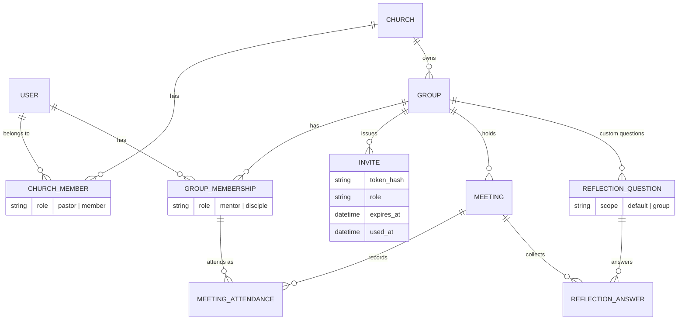
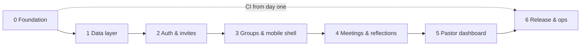

# Flock — Project Roadmap

> Last updated: 2026-11-15 · Current progress: [PROGRESS.md](./PROGRESS.md)

## Problem statement

Flock is a church leadership tool. A pastor oversees discipleship groups, and in each group the mentors track meeting attendance and reflections with their disciples. Each user's role depends on the group (someone can be a mentor in one group and a disciple in another), so the permission model has to take the current group into account.

## Guiding principles

1. **Mobile-first for mentors and disciples.** Phone-sized screens are the main target. The web app comes second and starts out focused on pastor administration and reporting.
2. **One loop, done well.** Meet → record → reflect → review → oversee. Anything outside that loop is a future feature.
3. **Roles belong to the group membership, never to the user.** Authorization always asks "what is this user's role in _this_ group?"
4. **Pastoral data is sensitive.** Reflections are personal. Each role sees only what it needs to see.
5. **Type-safe end to end.** Drizzle → Elysia → Eden Treaty → React Native, with validation schemas shared through `packages/shared`.
6. **Portfolio quality.** Clean architecture, automated checks from early on, and every phase leaves a demo that works.

---

## Requirements

| Area                       | Requirement                                                                                                                                                                                                    |
| -------------------------- | -------------------------------------------------------------------------------------------------------------------------------------------------------------------------------------------------------------- |
| **Hierarchy**              | Church (pastor) → Discipleship Group → 1–2 Mentors + up to 3 Disciples. Group size limits are enforced by the API.                                                                                             |
| **Roles**                  | `pastor` is a church-level role. `mentor` / `disciple` are group-level roles. One user can hold different roles in different groups.                                                                           |
| **Authentication**         | Invite-only: pastor invites mentors, mentors invite disciples. Invites are tied to a group and a role, expire, and can only be used once.                                                                      |
| **Meeting tracking**       | Attendance plus reflection (default questions + custom questions per mentor/group).                                                                                                                            |
| **Privacy**                | Disciples see their own answers. Mentors see the answers in their own group. Pastors see **aggregates** (attendance, response rates), not individual answer content. _(see [Open questions](#open-questions))_ |
| **Mobile UX**              | Touch-friendly, accessible, handles the keyboard properly, never scrolls horizontally, and has explicit loading, error and empty states.                                                                       |
| **Mobile session & links** | Sessions are kept in secure platform storage. Invite links open the app (`flock://` scheme / universal links), or fall back to web onboarding.                                                                 |
| **Offline**                | Out of scope for the MVP. Core workflows assume a network connection.                                                                                                                                          |
| **Material distribution**  | Deferred. A future Duolingo-inspired feature.                                                                                                                                                                  |

---

## Stack & architecture

```
monorepo (Turborepo + Bun workspaces)
├── apps/
│   ├── api/          → Bun + Elysia (exports `App` type for Eden Treaty)        ✅ scaffolded
│   ├── mobile/       → Expo + React Native + Expo Router                        ✅ scaffolded
│   └── web/          → React + Vite + TanStack Router/Query (pastor admin)      ⏳ Phase 5
├── packages/
│   ├── db/           → Drizzle ORM schema, migrations, seed                     ⏳ Phase 1
│   ├── shared/       → Platform-neutral types, validators, domain rules         ⏳ Phase 1
│   ├── config/       → Shared tsconfig presets                                  ⏳ Phase 0
│   └── ui/           → Only if web & native truly share primitives (optional)   💤 later
```

| Concern       | Choice                         | Notes                                                                                                                                                                                                    |
| ------------- | ------------------------------ | -------------------------------------------------------------------------------------------------------------------------------------------------------------------------------------------------------- |
| API           | Elysia + Eden Treaty           | Currently on **Elysia 2.0 RC**. Pin it, and move to stable once it's released.                                                                                                                           |
| Auth          | Better Auth                    | Server sessions. `@better-auth/expo` + `expo-secure-store` on mobile. Check whether the **organization plugin** (members, roles, invitations) can model church/pastor before building invites ourselves. |
| DB            | PostgreSQL + Drizzle Kit       | Docker Compose for local development.                                                                                                                                                                    |
| Validation    | TypeBox (Elysia native) or Zod | Pick **one** in Phase 1 and share it from `packages/shared`.                                                                                                                                             |
| Data fetching | TanStack Query + Eden Treaty   | Same pattern on mobile and web.                                                                                                                                                                          |
| Lint/format   | Biome                          | Single tool for the whole repo (replaces `expo lint` / ESLint).                                                                                                                                          |
| Testing       | `bun test`                     | API integration tests run against a real Postgres (Docker). Shared domain logic gets unit tests.                                                                                                         |
| Mobile builds | EAS Build / EAS Submit         | Internal distribution first, stores later.                                                                                                                                                               |

### Data model: group-scoped membership



> [!NOTE]
> Change from the previous roadmap: `pastor` is no longer a value in `group_memberships.role`. It is a **church-level** role, which matches the requirement that a pastor oversees groups rather than belonging to them. An `invites` table is now part of the schema too, since the auth phase depends on it.

---

## Phases at a glance

| Phase | Theme                              | Status         | Demo at the end                                                    |
| ----- | ---------------------------------- | -------------- | ------------------------------------------------------------------ |
| 0     | Foundation & tooling               | 🟡 ~70%        | `bun dev` runs API + Expo; CI is green on each PR                  |
| 1     | Data layer & shared domain         | ⚪ Not started | Migrations + seed; data browsable in Drizzle Studio                |
| 2     | Auth & invites                     | ⚪ Not started | Open an invite link on a phone → account created → added to group  |
| 3     | Groups & mobile shell              | ⚪ Not started | User with 2 memberships switches group context on mobile           |
| 4     | Meetings & reflections (core loop) | ⚪ Not started | Mentor logs meeting → disciple reflects → mentor reviews           |
| 5     | Pastor web dashboard               | ⚪ Not started | Pastor sees all groups' health in a responsive dashboard           |
| 6     | Release & operations               | ⚪ Not started | Merge to `main` deploys API + web; EAS produces installable builds |



---

## Phase 0: Foundation & tooling 🟡

**Objective:** A monorepo where every workspace installs, type-checks, lints and runs from the root, with automated checks on every PR.

**Done**

- [x] Turborepo + Bun workspaces (`apps/*`, `packages/*`), Bun version pinned
- [x] Expo app (`apps/mobile`) with Expo Router, typed routes, React Compiler, `flock://` scheme
- [x] Elysia API (`apps/api`) with a `/hi` route and `bun --watch` dev script
- [x] Biome config + root `check` / `lint` scripts wired into Turbo
- [x] `dev` and `build` Turbo pipelines

**Remaining**

- [ ] Add `tsconfig.json` to `apps/api` (plus a shared preset in `packages/config`)
- [ ] Add a `typecheck` script (`tsc --noEmit`) to every workspace and a `typecheck` Turbo task
- [ ] Remove `expo lint` from `apps/mobile` (Biome replaces it) and align `.vscode` settings with Biome
- [ ] Export `type App = typeof app` from the API so Eden Treaty clients can use it
- [ ] Read API config from env (`PORT`, etc.) with validation; add `.env.example`; ignore `.env*` at the root
- [ ] Add a `GET /health` endpoint (useful later for deploy health checks)
- [ ] Remove the leftover Expo template `LICENSE` from `apps/mobile`
- [ ] **CI (moved up from the old Task 9):** GitHub Actions running `bun install --frozen-lockfile`, `check`, `typecheck`, `test` on every PR

**Done when:** `bun dev` starts the API and Expo dev server; `bun check && bun typecheck` pass locally and in CI.

---

## Phase 1: Data layer & shared domain ⚪

**Objective:** Define the core data model and the domain rules that the API and clients both rely on.

**Implementation**

- `packages/db`: Drizzle schema for `users`, `churches`, `church_members`, `groups`, `group_memberships`, `invites`, `meetings`, `meeting_attendances`, `reflection_questions`, `reflection_answers`
- Constraints: unique `(user_id, group_id)` membership, FK cascades, timestamps, soft-delete where it makes sense
- Drizzle Kit migrations; root scripts `db:generate`, `db:migrate`, `db:studio`, `db:seed`
- Docker Compose for local PostgreSQL
- Seed script: one church, one pastor, two groups, and a user who is a mentor in one group and a disciple in the other
- `packages/shared`: role enums, validation schemas, and pure domain rules (e.g. `canAddMember(group, role)` for the 1–2 mentors / ≤3 disciples limits), with unit tests

**Done when:** `bun db:migrate && bun db:seed` run cleanly on a fresh database; Drizzle Studio shows all tables and relations; domain rule tests pass.

---

## Phase 2: Auth & invites ⚪

**Objective:** Better Auth in the API, with invite-only onboarding that works on mobile.

**Implementation**

- Better Auth with email/password and database sessions, mounted in Elysia
- Mobile: `@better-auth/expo` client, session stored in `expo-secure-store`
- Invites: hashed, single-use, expiring tokens linked to `(group, role)` (or to the church for mentors). Built on the Better Auth organization plugin if it fits.
- Permission rules: pastors can invite mentors; mentors can invite disciples to **their own** groups only
- Invite links: `flock://invite/<token>` + universal/app links, with a web fallback page
- The first pastor account is created through the seed script / a CLI command

**Tests:** token generation, expiry, reuse rejected, wrong-role invites rejected, group size limits respected when an invite is accepted.

**Done when:** A pastor creates an invite; opening the link on a phone launches the app, registers the user, and adds them to the right group with the right role.

---

## Phase 3: Groups & mobile shell ⚪

**Objective:** Group/membership API plus the authenticated mobile app shell with group-aware navigation.

**API**

- Group CRUD (pastor only), member listing per group, removing members
- A **group-context guard** (Elysia derive/macro) that resolves `{ user, group, role }` for each request
- Role-guard tests: a mentor can't create groups; a disciple can't read another group's data

**Mobile**

- Login, invite-onboarding and protected route groups in Expo Router
- Eden Treaty client + TanStack Query provider
- Home screen that lists the user's groups with their role in each
- A clear group switcher; the current group and role are always visible
- Shared loading, error and empty state components; check accessibility (font scaling, screen reader labels)

**Done when:** A user with two memberships sees both groups on their phone, can tell which role they have in each, and can switch between them without losing their place.

---

## Phase 4: Meetings & reflections (the core loop) ⚪

**Objective:** Mentors record meetings and attendance; disciples answer reflections; mentors review them.

**Meetings**

- Create/list/edit meetings per group (mentors of that group only)
- Mark attendance per disciple, in a few taps and without horizontal scrolling

**Reflections**

- Default questions seeded; mentors add, reorder and archive custom questions for their group
- Disciples submit answers per meeting (and can edit them for a limited time)
- Mentor view: per-meeting response summary and per-disciple history

**Tests:** only a group's mentors create meetings; attendance only covers group members; disciples answer only their own group's questions; mentors read only their own group's answers.

**Done when:** On phones, a mentor records a meeting, a disciple completes the reflection, and the mentor reads the response.

---

## Phase 5: Pastor web dashboard ⚪

**Objective:** A responsive web app for pastor administration and reporting.

> [!NOTE]
> The web app is created **here**, not during scaffolding (the old Task 1). With a mobile-first approach, there's no need to maintain a web app before pastors have data to look at.

**Implementation**

- Scaffold `apps/web` (React + Vite + TanStack Router/Query) using the same Eden Treaty client and Better Auth
- Aggregated stats endpoint: attendance rate, meetings per period, reflection response rate, "groups with no meeting in N weeks"
- Dashboard with charts (Recharts) that stays readable on phones
- Admin: create groups, invite mentors, manage memberships

**Tests:** aggregation logic tested against seeded data; pastors only see their own church's groups.

**Done when:** A pastor sees attendance and engagement summaries for every group they oversee, and can create a group and invite a mentor from the web.

---

## Phase 6: Release & operations ⚪

**Objective:** Deploy everything and produce real mobile builds.

- CI: add Turborepo remote caching; run build jobs for API, web and mobile
- API → Railway or Fly.io (with managed Postgres); migrations run on deploy
- Web → Vercel or Cloudflare Pages
- Mobile → EAS Build (internal distribution first), EAS Update for over-the-air updates, store submission later
- Separate env/secrets for preview and production
- Error tracking (e.g. Sentry) for API and mobile; structured logging in the API
- Privacy basics: data export and account deletion; a privacy policy page (needed for app stores, and for LGPD/GDPR)

**Done when:** PRs show green checks; merging to `main` deploys API + web; EAS produces installable iOS and Android builds.

---

## Future features

- **Material distribution**: Duolingo-inspired lessons/content delivered through the app
- **Notifications**: meeting reminders and nudges to answer reflections (Expo push notifications)
- **Pastor reporting**: exportable reports per group or period
- **Internationalization**: pt-BR / en
- **Offline support**: record meetings without a connection and sync later
- **Multiple pastors per church**: support for larger churches and staff roles

---

## Open questions

| #   | Question                                                                               | Why it matters                                                |
| --- | -------------------------------------------------------------------------------------- | ------------------------------------------------------------- |
| 1   | Should pastors be able to read individual reflection answers, or only aggregates?      | Trust and privacy; shapes the permission model                |
| 2   | Better Auth organization plugin vs. our own `church_members` + `invites` tables?       | Less custom code vs. full control over the group-scoped model |
| 3   | TypeBox or Zod for shared validation?                                                  | TypeBox is native to Elysia; Zod is more familiar on clients  |
| 4   | Can a group exist with zero mentors (e.g. while waiting for an invite to be accepted)? | Affects the size-limit rules and onboarding order             |
| 5   | Should Flock support multiple churches from day one, or one church per deployment?     | Changes the schema and tenancy isolation                      |
| 6   | What happens when a mentor leaves (reassign group, archive, keep history)?             | Data lifecycle and pastor admin features                      |

---

## Changelog of this roadmap

- **2026-11-15**: Reorganized into phases with status. Moved basic CI to Phase 0. Moved web app scaffolding to Phase 5. Made `pastor` a church-level role and added `churches` / `church_members` / `invites` to the schema. Switched auth from "JWT sessions" to Better Auth sessions + secure storage on mobile. Added principles, privacy requirements, operations and open questions.
- **2026-10-21**: Made the roadmap mobile-first.
- **2026-09-11**: Initial roadmap.
